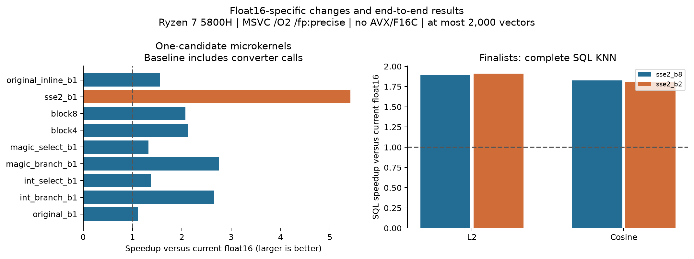
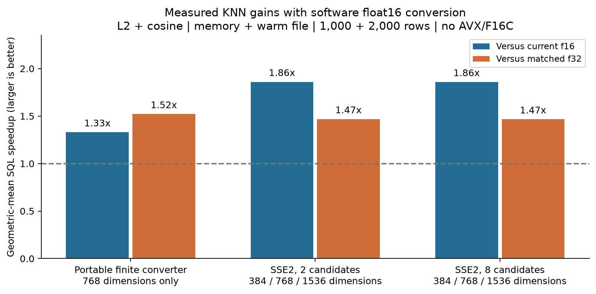
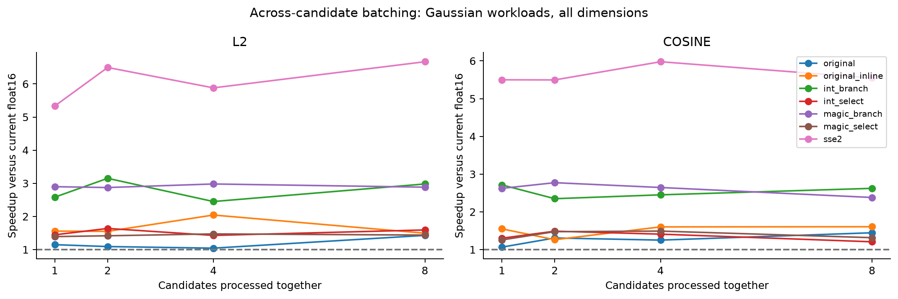
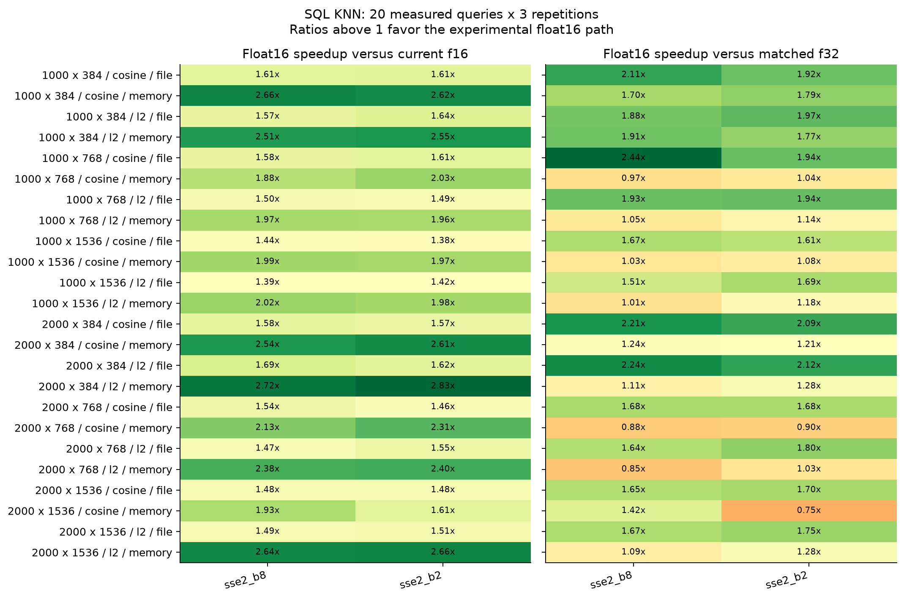
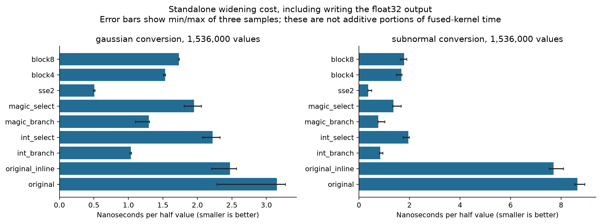

# Portable float16 KNN experiment results

Measured on **AMD Ryzen 7 5800H with Radeon Graphics**, Windows, Microsoft (R) C/C++ Optimizing Compiler Version 19.50.35721 for x64. Production files were not changed. All datasets contained at most **2,000 vectors**.

## Conclusions

- **sse2_b8**: geometric-mean SQL speedup **1.86x** over current float16; **1.47x** versus its matched float32 implementation. Faster than current float16 in **24/24** primary cases.
- **sse2_b2**: geometric-mean SQL speedup **1.86x** over current float16; **1.47x** versus its matched float32 implementation. Faster than current float16 in **24/24** primary cases.
- **magic_branch_b1**: geometric-mean SQL speedup **1.33x** over current float16 and **1.52x** versus matched scalar float32 across its **8** primary cases at 768 dimensions. This isolates a useful half-specific improvement without explicit SIMD or candidate batching.

These averages are not universal wins over float32: several memory-backed cases favor matched float32, as the heatmap below shows. The matched float32 distance microkernels are also faster than float16. The end-to-end float16 advantage is consistent with smaller stored vectors and reduced blob traffic, but cache/copy costs were not instrumented, so that explanation remains an inference.

The strongest one-candidate portable converter was **magic_branch_b1**, with **2.76x** microkernel speedup over the original float16 path on Gaussian workloads. Inlining the original converter alone gives **1.55x**; the new converter is **1.77x** relative to that inlining-only control. This separates half decoding/call overhead from candidate batching. SSE2 and batching must also be judged against their matched float32 controls.

**Microbenchmark compiler caveat:** the multi-variant DLL leaves an out-of-line `vec_half_to_float` call in the original kernel; the smaller baseline SQL DLL inlines conversion in its L2 distance function. Translation-unit context changes MSVC inlining decisions despite identical flags. Therefore the headline microkernel speedups are not predicted SQL speedups, and the inlining-only improvement must not be attributed to the production SQL path. The forced-inline ablation retains the original converter arithmetic, including exceptional cases and its normalization loop. Use the SQL results for the recommendation.

The portable diagnostic **magic_branch_b1** also received SQL confirmation at 768 dimensions; see its separate table below.

Finalists were selected by geometric-mean full-distance speedup across 16 Gaussian/normalized-Gaussian dimension/metric combinations. Selection used kernel measurements; SQL measurements are a separate confirmation. Ratios are baseline time / candidate time; above 1 is faster.

## Ablation: where the improvement comes from

| Configuration | Gaussian f16 kernel speedup | Zero-heavy | Subnormal-heavy | Matched f32 / f16 | Vectorization-off / on time |
|---|---:|---:|---:|---:|---:|
| original_b1 | 1.11x | 1.08x | 1.06x | 0.27x | 1.10x |
| original_b2 | 1.20x | 1.09x | 1.04x | 0.18x | 1.07x |
| original_b4 | 1.14x | 1.15x | 1.08x | 0.15x | 1.01x |
| original_b8 | 1.44x | 1.26x | 1.11x | 0.19x | 1.30x |
| int_branch_b1 | 2.65x | 1.50x | 8.40x | 0.64x | 1.07x |
| int_branch_b2 | 2.72x | 1.48x | 7.26x | 0.44x | 0.93x |
| int_branch_b4 | 2.45x | 1.42x | 6.61x | 0.32x | 0.86x |
| int_branch_b8 | 2.80x | 1.47x | 7.29x | 0.39x | 1.04x |
| int_select_b1 | 1.37x | 1.99x | 4.69x | 0.34x | 0.81x |
| int_select_b2 | 1.56x | 1.87x | 4.35x | 0.24x | 1.05x |
| int_select_b4 | 1.42x | 1.68x | 4.40x | 0.18x | 0.97x |
| int_select_b8 | 1.39x | 1.74x | 4.10x | 0.20x | 1.01x |
| magic_branch_b1 | 2.76x | 1.57x | 6.88x | 0.68x | 1.02x |
| magic_branch_b2 | 2.82x | 1.54x | 7.24x | 0.44x | 1.09x |
| magic_branch_b4 | 2.81x | 1.63x | 7.84x | 0.36x | 0.85x |
| magic_branch_b8 | 2.62x | 1.62x | 6.81x | 0.37x | 0.89x |
| magic_select_b1 | 1.32x | 1.71x | 4.73x | 0.33x | 0.80x |
| magic_select_b2 | 1.45x | 1.76x | 4.48x | 0.23x | 0.84x |
| magic_select_b4 | 1.48x | 1.90x | 5.78x | 0.19x | 0.91x |
| magic_select_b8 | 1.38x | 1.68x | 4.37x | 0.20x | 0.92x |
| block4 | 2.13x | 1.32x | 5.85x | 0.52x | 0.93x |
| block8 | 2.08x | 1.43x | 5.50x | 0.51x | 0.78x |
| sse2_b1 | 5.42x | 6.30x | 17.17x | 0.51x | 0.89x |
| sse2_b2 | 5.98x | 7.02x | 16.71x | 0.35x | 0.96x |
| sse2_b4 | 5.93x | 7.41x | 17.04x | 0.26x | 0.94x |
| sse2_b8 | 6.08x | 7.73x | 18.75x | 0.28x | 1.00x |
| sse2_candidates4 | 3.68x | 4.92x | 12.10x | 0.36x | 0.93x |
| original_inline_b1 | 1.55x | 1.33x | 1.02x | 0.37x | 0.96x |
| original_inline_b2 | 1.40x | 1.38x | 1.08x | 0.22x | 0.84x |
| original_inline_b4 | 1.81x | 1.42x | 1.11x | 0.23x | 0.97x |
| original_inline_b8 | 1.55x | 1.55x | 1.15x | 0.21x | 0.79x |

`original_b1` is the matched scalar control. Unlike historical float32 cosine, experimental float32 precomputes the query norm outside the candidate loop: once per scan in microbenchmarks, once per chunk in SQL. Float16 retains its existing once-per-query norm. These SQL cases use one or two chunks, so this is a small remaining outer-loop asymmetry; the candidate arithmetic/batching is matched. Compare against matched float32, not only the historical baseline. The two branched finite converters share the same normal-value algorithm; tiny differences on normal-heavy data are not evidence of a winner.

## SQL results

Each cell aggregates three per-run medians; p95 is the median of three per-run p95 values. Complete individual samples, insertion times, error checks and memory readings are in [sql.json](sql.json) and [sql.csv](sql.csv). The production `vec_debug()` string still says scalar because it does not know about the isolated scan hook; the build label/selected ID and frozen source identify the actual experimental kernel.

| Rows x dims / metric / storage / eligible % | Baseline f16 median / p95 ms | Baseline f32 median ms | sse2_b8 f16 median / p95 ms; speedup | sse2_b2 f16 median / p95 ms; speedup |
|---|---:|---:|---:|---:|
| 1000 x 384 / cosine / file / 100% | 0.878 / 0.926 | 1.269 | 0.547 / 0.556; 1.61x | 0.544 / 0.610; 1.61x |
| 1000 x 384 / cosine / memory / 100% | 0.551 / 0.585 | 0.636 | 0.207 / 0.218; 2.66x | 0.210 / 0.230; 2.62x |
| 1000 x 384 / l2 / file / 100% | 0.869 / 0.915 | 1.261 | 0.552 / 0.572; 1.57x | 0.529 / 0.561; 1.64x |
| 1000 x 384 / l2 / memory / 100% | 0.506 / 0.538 | 0.609 | 0.202 / 0.228; 2.51x | 0.199 / 0.209; 2.55x |
| 1000 x 768 / cosine / file / 100% | 2.162 / 2.635 | 3.009 | 1.372 / 1.412; 1.58x | 1.341 / 1.450; 1.61x |
| 1000 x 768 / cosine / memory / 100% | 1.285 / 1.335 | 1.256 | 0.683 / 0.738; 1.88x | 0.634 / 0.678; 2.03x |
| 1000 x 768 / l2 / file / 100% | 1.968 / 2.016 | 2.905 | 1.313 / 1.366; 1.50x | 1.321 / 1.397; 1.49x |
| 1000 x 768 / l2 / memory / 100% | 1.285 / 1.382 | 1.170 | 0.651 / 0.677; 1.97x | 0.654 / 0.710; 1.96x |
| 1000 x 1536 / cosine / file / 100% | 4.325 / 4.542 | 6.060 | 3.005 / 3.135; 1.44x | 3.141 / 3.294; 1.38x |
| 1000 x 1536 / cosine / memory / 100% | 2.452 / 2.554 | 2.556 | 1.232 / 1.345; 1.99x | 1.243 / 1.378; 1.97x |
| 1000 x 1536 / l2 / file / 100% | 4.331 / 4.576 | 6.036 | 3.107 / 3.247; 1.39x | 3.058 / 3.151; 1.42x |
| 1000 x 1536 / l2 / memory / 100% | 2.516 / 2.571 | 2.309 | 1.244 / 1.310; 2.02x | 1.270 / 1.430; 1.98x |
| 2000 x 384 / cosine / file / 100% | 1.757 / 1.795 | 2.808 | 1.111 / 1.144; 1.58x | 1.122 / 1.218; 1.57x |
| 2000 x 384 / cosine / memory / 100% | 1.072 / 1.095 | 1.048 | 0.423 / 0.454; 2.54x | 0.411 / 0.427; 2.61x |
| 2000 x 384 / l2 / file / 100% | 1.817 / 1.990 | 2.894 | 1.074 / 1.110; 1.69x | 1.120 / 1.181; 1.62x |
| 2000 x 384 / l2 / memory / 100% | 1.066 / 1.168 | 0.963 | 0.392 / 0.434; 2.72x | 0.377 / 0.400; 2.83x |
| 2000 x 768 / cosine / file / 100% | 4.187 / 4.308 | 5.680 | 2.711 / 3.008; 1.54x | 2.860 / 3.030; 1.46x |
| 2000 x 768 / cosine / memory / 10% | 0.556 / 0.681 | 0.838 | 0.430 / 0.493; 1.29x | 0.461 / 0.563; 1.20x |
| 2000 x 768 / cosine / memory / 50% | 1.437 / 1.540 | 1.329 | 0.744 / 0.872; 1.93x | 0.707 / 0.805; 2.03x |
| 2000 x 768 / cosine / memory / 100% | 2.314 / 2.408 | 2.131 | 1.086 / 1.136; 2.13x | 1.000 / 1.090; 2.31x |
| 2000 x 768 / l1 / memory / 100% | 2.311 / 2.358 | 2.028 | 0.935 / 1.014; 2.47x | 0.973 / 1.033; 2.38x |
| 2000 x 768 / l2 / file / 100% | 4.127 / 4.278 | 5.249 | 2.800 / 2.912; 1.47x | 2.659 / 2.844; 1.55x |
| 2000 x 768 / l2 / memory / 10% | 0.565 / 0.634 | 0.851 | 0.430 / 0.491; 1.31x | 0.424 / 0.507; 1.33x |
| 2000 x 768 / l2 / memory / 50% | 1.319 / 1.412 | 1.270 | 0.688 / 0.731; 1.92x | 0.685 / 0.782; 1.92x |
| 2000 x 768 / l2 / memory / 100% | 2.323 / 2.475 | 1.929 | 0.976 / 1.130; 2.38x | 0.967 / 1.089; 2.40x |
| 2000 x 1536 / cosine / file / 100% | 7.955 / 8.195 | 11.469 | 5.362 / 5.714; 1.48x | 5.363 / 5.635; 1.48x |
| 2000 x 1536 / cosine / memory / 100% | 4.963 / 5.455 | 4.226 | 2.567 / 3.066; 1.93x | 3.082 / 3.523; 1.61x |
| 2000 x 1536 / l2 / file / 100% | 7.986 / 8.312 | 10.619 | 5.362 / 5.847; 1.49x | 5.283 / 5.460; 1.51x |
| 2000 x 1536 / l2 / memory / 100% | 5.882 / 7.113 | 5.446 | 2.230 / 2.358; 2.64x | 2.211 / 2.347; 2.66x |

### Portable conversion diagnostic

| Rows / metric / storage / eligible % (768 dimensions) | f16 median / p95 ms | Speedup vs current f16 | Matched f32 / f16 |
|---|---:|---:|---:|
| 1000 / cosine / file / 100% | 1.620 / 1.647 | 1.33x | 1.86x |
| 1000 / cosine / memory / 100% | 0.964 / 1.001 | 1.33x | 1.21x |
| 1000 / l2 / file / 100% | 1.615 / 1.688 | 1.22x | 1.84x |
| 1000 / l2 / memory / 100% | 0.886 / 0.965 | 1.45x | 1.35x |
| 2000 / cosine / file / 100% | 3.511 / 3.633 | 1.19x | 1.64x |
| 2000 / cosine / memory / 10% | 0.557 / 0.609 | 1.00x | 1.58x |
| 2000 / cosine / memory / 50% | 0.979 / 1.054 | 1.47x | 1.52x |
| 2000 / cosine / memory / 100% | 1.640 / 1.777 | 1.41x | 1.28x |
| 2000 / l1 / memory / 100% | 1.509 / 1.598 | 1.53x | 1.22x |
| 2000 / l2 / file / 100% | 3.157 / 3.288 | 1.31x | 1.82x |
| 2000 / l2 / memory / 10% | 0.496 / 0.540 | 1.14x | 1.76x |
| 2000 / l2 / memory / 50% | 0.963 / 1.040 | 1.37x | 1.45x |
| 2000 / l2 / memory / 100% | 1.648 / 1.687 | 1.41x | 1.35x |

## Conversion cost and footprint

Standalone conversion writes a float32 array; fused distance kernels do not. These measurements diagnose conversion throughput, but subtracting them from full-distance time would not yield a valid time breakdown.

| Build | Executable .text bytes | Read-only .rdata bytes | Largest experimental scan stack frame, including saved GPRs |
|---|---:|---:|---:|
| baseline | 114,456 | 31,798 | Not applicable |
| sse2_b8 | 136,968 | 32,598 | 552 |
| sse2_b2 | 127,000 | 32,582 | 280 |
| magic_branch_b1 | 120,472 | 32,310 | 152 |

No LUT or persistent expanded-vector cache is allocated. The query buffer already present in float16 uses `4 * dimensions` bytes. Candidate pointers/IDs/results require at most `16 * batch_width` logical staging bytes on x64, plus arithmetic temporaries. The table reports the largest compiled scan frame across dtypes/metrics, not total call-stack usage; it includes local allocation and pushed general-purpose registers, excludes the return address and callees. Read-only section sizes include compiler constants, strings and other extension metadata, not just conversion constants.

| Rows x dimensions | Float16 database bytes | Matched float32 database bytes | Ratio |
|---|---:|---:|---:|
| 1000 x 384 | 856,064 | 1,642,496 | 1.92x |
| 1000 x 768 | 1,642,496 | 3,215,360 | 1.96x |
| 1000 x 1536 | 3,215,360 | 6,365,184 | 1.98x |
| 2000 x 384 | 1,675,264 | 3,248,128 | 1.94x |
| 2000 x 768 | 3,248,128 | 6,402,048 | 1.97x |
| 2000 x 1536 | 6,402,048 | 12,701,696 | 1.98x |

## Correctness and reproducibility

- Every specialized converter passed all **63,488 finite encodings**; both general converter forms passed all **65,536 encodings**. Signed zeros, NaN classification and all four FTZ/DAZ combinations were checked with unaligned input.
- Both default and `loop(no_vector)` builds passed the distance grid: **14,976** variant/dtype/metric/distribution/dimension checks, plus maximum-finite stress cases.
- SQL extensions passed the existing float16 suite and extra matched-float32 tests covering ties, deletions, filtered searches, empty matches, short batches and `k=0`/`k>eligible`.
- All measured SQL answers passed float64 distance and top-k threshold checks. Maximum absolute returned-distance error was **0.000353**. Original-float32 top-10 overlap averaged **99.98%**, minimum **90.0%**, on these synthetic queries. Near-tie rounding is handled with the existing tolerance.
- Same half-rounded base/query values are stored in both dtypes. Original float32 comparisons are accuracy checks only.
- SQL settings: 4 KiB pages, 1,024-row chunks, 64 MiB SQLite cache, mmap disabled; file runs use WAL and synchronous FULL. Reads are warm. Insertion includes commits every 1,000 rows; input serialization and correctness references are outside query timing. Query widening inside SQLite remains timed.
- Five SQL warmups, twenty timed queries, three repetitions, sequential fresh workers and one numerical-library thread. Variant order rotates across cases and reverses on alternate repetitions. Microbenchmarks use a warmup/calibration and three samples of bounded repeated scans.
- MSVC ignores the initially proposed `/Qvec-` flag. The final control uses documented `__pragma(loop(no_vector))` on measured loops; discarded preliminary control results are not included. Explicit SSE2 intrinsics remain SIMD in that control.
- Disassembly contains no AVX/F16C, SSE3/SSE4, LZCNT or TZCNT requirements in measured floating-point paths. Existing MSVC Hamming code emits POPCNT; it is unrelated, unchanged and never called here. The whole library is therefore not certified as universally SSE2-only.
- Results are local Ryzen evidence, not an emulation of older hardware. Frequency, thermals, scheduling and shared-machine activity remain sources of variability. No CPU affinity or frequency lock was imposed.
- Raw measurements and CSV exports are in this directory. [Environment and source hashes](environment.json), [micro builds](builds-micro.json), [SQL builds](builds-sql.json), [kernel correctness](correctness-micro.json), and [SQL correctness](correctness-sql.json) preserve provenance. Reproduction commands are in [README](../README.md).

## CPU support and research

| Feature | This Ryzen 7 5800H | Steam Windows, August 2026 |
|---|---|---:|
| SSE2 | Supported | 100.00% |
| AVX | Supported; OS usability separately confirmed with .NET | 99.15% |
| AVX2 | Supported | 97.30% |
| F16C | Supported | 98.54% |
| AVX-512F | Not supported | 24.46% |

[Steam Hardware Survey](https://store.steampowered.com/hwsurvey/?l=english&platform=pc), inspected September 26, 2026. Voluntary Steam Windows participants are not representative of all consumer devices. SSE2 is the [default Windows x64 compiler baseline](https://learn.microsoft.com/en-us/cpp/build/reference/arch-x64?view=msvc-170); portable C remains necessary for ARM and WASM.

Conversion references: [FP16 implementation](https://github.com/Maratyszcza/FP16/blob/master/include/fp16/fp16.h), [Giesen, Half to float done quick](https://fgiesen.wordpress.com/2012/03/28/half-to-float-done-quic/). Candidate-batching precedent: [Faiss distance interfaces](https://github.com/facebookresearch/faiss/blob/main/faiss/utils/distances.h). These are research references, not dependencies.

## Recommendation

- **sse2_b8** has non-overlapping per-run-median ranges favoring it in **24/24** primary SQL cases. This is an observed range check, not a statistical confidence interval.
- **sse2_b2** has non-overlapping per-run-median ranges favoring it in **24/24** primary SQL cases. This is an observed range check, not a statistical confidence interval.

Recommend the finite-only branched converter as the portable follow-up, and **SSE2 with two candidates** as the x64 follow-up. Batches of two and eight are effectively tied in aggregate SQL performance; two adds less executable code (12.25 KiB versus 21.98 KiB) and has a smaller maximum experimental scan frame (280 versus 552 bytes). These code-size increases include the matched float32 implementations. Validate both choices on older hardware before production adoption. This deliverable leaves production defaults unchanged.
